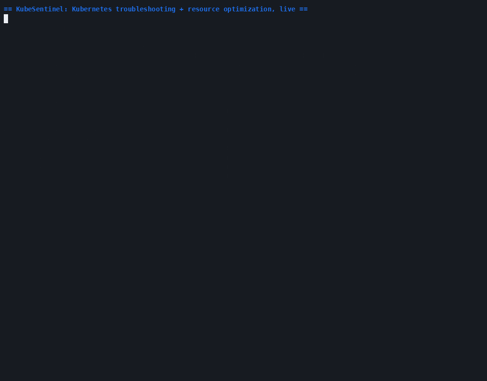

# KubeSentinel

A locally runnable Kubernetes troubleshooting and controlled self-healing platform.
Built to demonstrate real Kubernetes engineering depth: control-loop semantics,
observed-vs-inferred diagnosis, safe remediation policy, and recovery verification --
not a generated README wrapped around an LLM call.

Runs entirely on a local [kind](https://kind.sigs.k8s.io/) cluster. No paid cloud
services, no required AI model. See [DEMO_SCRIPT.md](docs/DEMO_SCRIPT.md) for a
guided walkthrough and [TODO.md](TODO.md) for exactly what is and isn't built yet.

## Demo



A real, unedited terminal session against a real kind cluster: what Kubernetes
itself reports vs. what KubeSentinel diagnoses, a full policy-controlled
`plan -> approve -> execute -> verify` remediation (correctly reporting
`VERIFICATION_FAILED` rather than lying about an action that didn't fix
anything), and the resource optimization engine producing a real
`CPU_OVERSIZED`/`MEMORY_OVERSIZED` recommendation from real metrics-server
samples. Recorded with [asciinema](https://asciinema.org) + [agg](https://github.com/asciinema/agg) --
every line is genuine command output, not staged.

## Status: Milestones 1-11 (troubleshooting) + 12-19 (resource optimization) + scheduling advisor + network troubleshooting engine + capacity planning advisor + security auditor complete -- the full platform spec (Capabilities A-F)

The full **observe -> diagnose -> persist -> expose** pipeline is implemented,
tested, and verified end-to-end against a real kind cluster for 13 of the 14
diagnostic categories in the original spec (DNS/connectivity deliberately
deferred -- see [TODO.md](TODO.md)): CrashLoopBackOff, OOMKilled,
ImagePullBackOff/ErrImagePull, missing ConfigMap/Secret references, pending-pod
scheduling constraints, readiness and liveness probe failures, Deployment
rollout failures, unsatisfied replica counts, PVC binding failures, in-Pod
volume mount failures, Node unschedulability, and Service/EndpointSlice
selector mismatches -- plus a transient-failure recovery scenario proving the
full observe-diagnose-recover loop.

Policy-controlled remediation is also implemented and live-verified: a policy
engine (OBSERVE/APPROVAL_REQUIRED/CONTROLLED_AUTO modes), a remediation
executor (restart/rollback/scale a Deployment, plus recommend-only actions), a
recovery verifier that polls the real cluster rather than trusting an action's
own reported success, and a full `plan -> approve -> execute -> reject`
lifecycle exposed over both a token-gated FastAPI surface and an equivalent
CLI. See [REMEDIATION_SAFETY.md](docs/REMEDIATION_SAFETY.md) for what's
enforced and how it was verified, and [TODO.md](TODO.md) for the full
milestone plan and current limitations (nothing yet triggers remediation from
the live diagnosis pipeline without a human or an explicit policy-engine
decision in the loop).

A second, read-only **resource optimization engine** sits alongside the
troubleshooting pipeline above, sharing its cluster client, SQLite file, and
`/metrics` endpoint without duplicating any of it: a workload inventory with
correct owner-reference resolution (Pod -> ReplicaSet -> Deployment,
StatefulSet/DaemonSet/Job, or standalone Pod), current usage from the
Kubernetes Metrics API (with an optional Prometheus upgrade for real
historical percentiles), and deterministic CPU/memory right-sizing --
percentile-based for CPU, peak-based for memory, never from a single sample,
never silently skipping an unhealthy workload (it's flagged instead). An open
troubleshooting incident on the same workload blocks a proposed number and
links back to it. There is deliberately no apply/execute endpoint: every
recommendation is a reviewable record (`new -> reviewed/approved/rejected ->
expired`), and analysis never mutates the cluster -- confirmed live with an
HTTP-transport-level check that an entire `analyze()` pass issues nothing but
GET requests. See [RESOURCE_OPTIMIZATION_DESIGN.md](docs/RESOURCE_OPTIMIZATION_DESIGN.md)
for the full design and TODO.md's Milestones 12-19 for the build and
live-verification history.

A third, read-only engine -- the **scheduling & placement advisor** --
follows the same shared-infrastructure pattern again: given a real Pending
Pod or a hypothetical spec, it independently reconstructs *why* a Node does
or doesn't fit, one constraint at a time (real Node allocatable-vs-requested
arithmetic, real taint/toleration matching, real node-selector/required-
node-affinity evaluation, real namespace-ResourceQuota checking for a
hypothetical spec), rather than only classifying the scheduler's own
message text the way the troubleshooting engine's `PendingSchedulingRule`
already does. It's explicit about what it *doesn't* evaluate too -- pod
affinity/anti-affinity and topology spread constraints are detected and
named, never guessed at. See
[SCHEDULING_ANALYSIS.md](docs/SCHEDULING_ANALYSIS.md) for the design.

A fourth, read-only engine -- the **network troubleshooting engine** --
explains a real Pod's inbound Service-based connectivity story: which
Services actually select it (computed independently, not inferred from
EndpointSlice counts), whether its EndpointSlice output agrees, whether
each Service's `targetPort` actually resolves against the Pod's declared
container ports (numeric and named `targetPort`s have genuinely different
Kubernetes semantics, both implemented precisely), whether cluster DNS
(CoreDNS/`kube-dns`) looks healthy, and which NetworkPolicies apply --
always as static policy analysis, never a claim about actually-observed
blocked traffic (this lab cluster's CNI doesn't enforce NetworkPolicy at
all). Every finding's reasoning ends with the same caveat: Kubernetes API
inspection can describe configuration, never prove a packet actually
arrives. An active, bounded connectivity probe was deliberately scoped
out of this engine -- it would be this project's first mutation surface
outside the fully policy-gated `RemediationExecutor`, and deserves its own
safety review rather than being folded into a static-analysis milestone.
See [NETWORK_DIAGNOSTICS.md](docs/NETWORK_DIAGNOSTICS.md) for the design.

A fifth capability -- the **capacity planning & autoscaling advisor** --
is additive work *inside* the resource optimization engine rather than a
new top-level package, per the spec's own explicit instruction not to
build a second metrics collector: it reuses the same workload inventory,
usage-history collection, and safety checks, and ships through the exact
same `/optimization/recommendations`/`kubesentinel recommendations`
surfaces under a new `CAPACITY` category. It reads a workload's real
`HorizontalPodAutoscaler` status (current/desired replicas, every
metric's current value vs. target, the real `ScalingLimited` condition),
flags when an HPA's Utilization target is meaningless because the
container has no corresponding resource request, and runs a coarse,
explicitly-approximate cluster-headroom check (reusing the scheduling
advisor's own Node allocatable math) for the specific case of an HPA
capped at its maximum while still over target. Memory-leak-shaped and
single-threaded-bottleneck signals are reported as pattern matches over
the existing usage samples, always labeled as such -- an external
dependency as a real bottleneck is named as a hard limitation this
project has no tracing/latency evidence for at all, never silently
assumed to be the cause. No apply/write path exists here either. See
[CAPACITY_PLANNING.md](docs/CAPACITY_PLANNING.md) for the design.

A sixth, read-only engine -- the **security & configuration auditor** --
is a native rule catalog (no kube-linter/Kubescape dependency -- a
deliberate build-vs-integrate decision, not an oversight) covering
container security context (privileged, allowPrivilegeEscalation,
runAsNonRoot, readOnlyRootFilesystem, host namespace sharing, hostPath
volumes, mutable image tags, Secrets as env vars), RBAC
over-permissiveness (cluster-admin bindings and wildcard verb+resource
rules, both excluding Kubernetes' own built-in, unfixable Roles/bindings
-- confirmed live that a real cluster has *two* such built-in identities,
not the one better-known one), NetworkPolicy coverage (namespaces with
zero policies, policies with an unrestricted-allow-all ingress rule,
reusing the network engine's own classification rather than re-reading
NetworkPolicy objects a second time), and PodDisruptionBudget coverage
for multi-replica workloads. Deliberately out of scope: CVE/image
vulnerability scanning (no maintained vulnerability database this
project has access to) and resolving a subject's *effective* permissions
across every Role it's bound to combined -- both named as real gaps, not
silently absent. No apply/write path exists here either. See
[SECURITY_AUDITING.md](docs/SECURITY_AUDITING.md) for the design.

Every stage above is exported as Prometheus metrics with bounded-cardinality
labels (category/action_type/reason/component, never incident IDs or pod
names) at `GET /metrics`. [observability/](observability/) has a scrape config
and an importable Grafana dashboard, both verified against the real server's
`/metrics` output -- which is also how a real gauge-accuracy bug
(`incidents_active` undercounting incidents that predated the current process)
was caught; see TODO.md's Known limitation #18.

All 9 lab failure scenarios (every diagnostic category this project implements,
one dedicated manifest each) plus 2 resource-optimization scenarios
(oversized requests, missing requests entirely) plus 1 scheduling-advisor
scenario (an impossible nodeSelector) plus 2 network-engine scenarios (a
Service selector matching no Pod, and a Service matching a real, Ready
Pod whose `targetPort` name doesn't resolve) plus 1 capacity-advisor
scenario (a real HPA pinned at its maximum, still over target) plus 1
security-auditor scenario (a privileged container, an over-permissive
ClusterRoleBinding, and an unrestricted-ingress NetworkPolicy) are built
and live-verified -- see [FAILURE_LAB.md](docs/FAILURE_LAB.md). The test suite now includes
integration and e2e tests that exercise the real cluster directly (RBAC
boundary enforcement, watch resync, UID-based dedup across a delete/recreate,
restart recovery, concurrent remediation requests, the full propose/approve/
execute/verify lifecycle against a real Deployment, the optimization
engine's own read-only guarantee and real-usage-data right-sizing, the
scheduling advisor's own independent constraint math reaching the same
conclusion the real scheduler already did, the network engine's own
independent selector/port matching reaching the right conclusion against
real Services/EndpointSlices/CoreDNS, the capacity advisor's own
HPA-status/scale-headroom reasoning reaching the right conclusion against
a real HorizontalPodAutoscaler and real Node capacity, and the security
auditor's own rule catalog reaching the right conclusion against real
RBAC/NetworkPolicy/container state while correctly never flagging the
cluster's own built-in RBAC bootstrap identities) --
`./scripts/test.sh --all` runs all 783 tests (715 unit + 68 integration/e2e);
see [TESTING.md](docs/TESTING.md).

Optional AI summarization (`kubesentinel explain <incident-id>`, or
`GET /incidents/{id}/ai-summary`) can turn an incident's existing diagnosis
into a plain-English explanation -- strictly advisory, never a new hypothesis
or a remediation decision. The only backend is a local [Ollama](https://ollama.com)
server: no API key, no cloud account, no per-request cost, genuinely free
rather than "free tier." Disabled by default; every feature above works fully
without it. See [RBAC_AND_THREAT_MODEL.md](docs/RBAC_AND_THREAT_MODEL.md) for
why it has no path back into any decision, and TODO.md's Milestone 11 entry
for live verification evidence.

```
Observer (watch Pods, Events, Deployments,  -->  Evidence extraction  -->  Diagnostic
PVCs, Nodes, EndpointSlices)                                                engine (rules)
                                                                                 |
                                                                                 v
                                               Incident manager (dedup by resource UID,
                                                      any kind -- Pod/Deployment/      |
                                                      PVC/Node/Service)                v
                                                            |                 Policy engine -> Remediation
                                                            v                 executor -> Recovery verifier
                                            SQLite persistence  <-->  FastAPI + CLI + /metrics
```

A second, read-only pipeline runs alongside it, sharing only the SQLite file
and (optionally) the incident manager's own repository for the `ACTIVE_INCIDENT`
check -- never a second cluster watch loop or a parallel incident concept:

```
Workload inventory (owner-reference   -->  Metrics API / Prometheus  -->  Deterministic
resolution: Pod -> ReplicaSet ->            usage providers                analyzer (CPU/memory
Deployment, StatefulSet/DaemonSet/Job)                                     right-sizing, pressure,
                                                                            data-quality)
                                                                                 |
                                                                                 v
                                                      Safety checks (flags unhealthy/system/
                                                      conservative workloads + ACTIVE_INCIDENT,
                                                      never silently drops a row)
                                                            |
                                                            v
                                            SQLite persistence  <-->  FastAPI + CLI + /metrics
```

A third pipeline, same shared infrastructure again, no new watch loop:

```
Node inventory (allocatable,          -->  Per-constraint evaluators    -->  Finding: per-node,
taints, labels) + a real or               (resource fit, taints,            per-constraint
hypothetical Pod spec                     node selector, required          pass/fail with real
                                           affinity, namespace quota)       arithmetic in the
                                                                            reasoning -- plus what
                                                                            wasn't evaluated
                                                            |
                                                            v
                                            SQLite persistence  <-->  FastAPI + CLI + /metrics
```

A fourth pipeline, same shared infrastructure again, one new read-only client
(`NetworkingV1Api`):

```
Service/Pod/EndpointSlice       -->  Independent selector/port       -->  Finding: classification
inventory + NetworkPolicy            matching, EndpointSlice             (healthy/config-error/
inventory + CoreDNS/kube-dns         consistency check, DNS             unready-endpoints/
health (read-only, kube-system       health, applicable                 dns-unhealthy/policy-
RBAC-scoped to those two names)      NetworkPolicy summaries            may-restrict/inconclusive)
                                                            |
                                                            v
                                            SQLite persistence  <-->  FastAPI + CLI + /metrics
```

A fifth capability extends the *second* pipeline above (resource
optimization) rather than adding a new one -- one new read-only client
(`AutoscalingV2Api`), zero new persistence or routes:

```
Workload inventory (reused)   -->  HPA status (reused scheduling    -->  CAPACITY finding:
+ real HPA status                  Node math for scale headroom)        HPA_AT_MAX/_AT_MIN,
                                    + trend/pattern checks over            missing-request,
                                    the existing sample window             leak/bottleneck patterns
                                                            |
                                                            v
                        Same ResourceRecommendation row  <-->  Same FastAPI/CLI/`/metrics` surfaces
```

A sixth pipeline, same shared infrastructure again, two new read-only
clients (`RbacAuthorizationV1Api`, `PolicyV1Api`) -- the full A-F
capability list from the platform spec is now complete:

```
Pod/RBAC/NetworkPolicy/PDB   -->  13 native rules (container        -->  SecurityFinding(s):
inventory (one-shot,              security context, RBAC                severity, evidence,
Pods grouped by owning            over-permissiveness, NetworkPolicy     explanation, remediation
workload, reused owner             coverage, PDB coverage) --
resolution)                        no external scanner dependency
                                                            |
                                                            v
                                            SQLite persistence  <-->  FastAPI + CLI + /metrics
```

## Quickstart

Prerequisites: Docker (or Colima), [kind](https://kind.sigs.k8s.io/), kubectl, Python 3.11+.

```bash
./scripts/check-prereqs.sh   # verify everything is installed and Docker is reachable
./scripts/setup.sh           # create .venv, install kubesentinel + dev deps, write .env
./lab/create-cluster.sh      # create the local kind cluster + kubesentinel-lab namespace
./scripts/test.sh            # ruff + mypy + unit tests (no cluster required)
./scripts/demo.sh            # apply failure scenarios and run the API server live
```

In a second terminal, while `./scripts/demo.sh` is running:

```bash
curl -s http://127.0.0.1:8000/incidents | python3 -m json.tool
.venv/bin/kubesentinel incidents
.venv/bin/kubesentinel diagnose kubesentinel-lab crashloop-demo-<pod-suffix>
.venv/bin/kubesentinel evidence <incident-id>
curl -s http://127.0.0.1:8000/metrics | grep kubesentinel_
```

Remediation defaults to `OBSERVE` mode (diagnose-only, nothing is ever executed)
until `KUBESENTINEL_POLICY_MODE` is set, and mutating API endpoints are disabled
(`503`) until `KUBESENTINEL_API_TOKEN` is set -- see
[REMEDIATION_SAFETY.md](docs/REMEDIATION_SAFETY.md). With those set, both
surfaces expose the same `plan -> approve -> execute -> reject` lifecycle:

```bash
.venv/bin/kubesentinel dry-run <incident-id> RESTART_DEPLOYMENT
.venv/bin/kubesentinel plan <incident-id> RESTART_DEPLOYMENT --rationale "manual override"
.venv/bin/kubesentinel approve <incident-id> <action-id> --approved-by "<your name>"
.venv/bin/kubesentinel execute <incident-id> <action-id>
```

The resource optimization engine needs no extra setup to run -- without
metrics-server installed, it still produces honest, non-usage-based
recommendations (missing requests/limits, scheduling pressure). To see
CPU/memory right-sizing with real usage data too, install metrics-server
first (`./lab/install-metrics-server.sh`, optional, kind-specific):

```bash
.venv/bin/kubesentinel optimize --namespace kubesentinel-lab
.venv/bin/kubesentinel recommendations
.venv/bin/kubesentinel recommendation <recommendation-id>
.venv/bin/kubesentinel optimization-summary
.venv/bin/kubesentinel review-recommendation <recommendation-id> APPROVED --reviewed-by "<your name>"
```

The scheduling advisor explains a real Pending Pod, or simulates a
hypothetical spec that doesn't exist yet -- also no extra setup needed:

```bash
.venv/bin/kubesentinel schedule-check kubesentinel-lab <pod-name>
.venv/bin/kubesentinel scheduling-findings
.venv/bin/kubesentinel scheduling-finding <finding-id>
```

The network troubleshooting engine explains a real Pod's inbound
Service-based connectivity story -- also no extra setup needed:

```bash
.venv/bin/kubesentinel network-check kubesentinel-lab <pod-name>
.venv/bin/kubesentinel network-findings
.venv/bin/kubesentinel network-finding <finding-id>
```

Capacity/HPA findings surface through the same optimization-engine
commands as CPU/MEMORY/SCHEDULING, under a new category:

```bash
.venv/bin/kubesentinel optimize --namespace kubesentinel-lab
.venv/bin/kubesentinel recommendations --category CAPACITY
.venv/bin/kubesentinel recommendation <recommendation-id>
```

The security & configuration auditor runs a cluster-wide audit -- also
no extra setup needed:

```bash
.venv/bin/kubesentinel security-audit --namespace kubesentinel-lab
.venv/bin/kubesentinel security-findings --severity CRITICAL
.venv/bin/kubesentinel security-finding <finding-id>
```

AI summarization is off by default (works with no AI at all). To try it:
[install Ollama](https://ollama.com), `ollama pull qwen2.5-coder:3b` (or any
model you have), then:

```bash
KUBESENTINEL_AI_ENABLED=true .venv/bin/kubesentinel explain <incident-id>
# or restart ./scripts/demo.sh with KUBESENTINEL_AI_ENABLED=true and:
curl -s http://127.0.0.1:8000/incidents/<incident-id>/ai-summary
```

When done: `Ctrl+C` the demo server, then `./lab/delete-cluster.sh` to tear the
cluster down (destructive, scoped only to the `kubesentinel` kind cluster).

## Image caching note for kind on macOS/Colima

If your Docker daemon's outbound network can't reach Docker Hub (seen in this
project's own dev environment -- confirmed via `docker pull` timing out while the
host's own network could reach the registry directly), pre-load images into the kind
node instead of relying on an in-cluster pull:

```bash
docker pull busybox:latest        # or any image already cached on the host
docker save busybox:latest -o /tmp/busybox.tar
docker cp /tmp/busybox.tar kubesentinel-control-plane:/root/busybox.tar
docker exec kubesentinel-control-plane ctr --namespace=k8s.io images import --digests --snapshotter=overlayfs /root/busybox.tar
```

Also make sure any manifest using a mutable tag like `:latest` sets
`imagePullPolicy: IfNotPresent` -- Kubernetes defaults `:latest` to `imagePullPolicy:
Always`, which forces a network round-trip on every pod start even when the image is
already cached locally. This bit us directly while building the lab scenarios; see
[TROUBLESHOOTING.md](docs/TROUBLESHOOTING.md).

## Project layout

```
src/kubesentinel/
  models/        Pydantic models: Evidence, Hypothesis, DiagnosisResult, Incident, Action,
                 and the optimization engine's WorkloadSnapshot/ResourceRecommendation
  observer/      Kubernetes client setup, watch loops with reconnect/resync, evidence extraction
  diagnostics/   Deterministic rule-based diagnostic engine + individual rules
  incidents/     Incident lifecycle: dedup by resource UID, health classification, severity
  optimization/  Read-only resource right-sizing: inventory, metrics providers, analyzer, safety,
                 and capacity.py (HPA status/scale-headroom reasoning, Milestone 5)
  scheduling/    Read-only placement analysis: node inventory, per-constraint evaluators, analyzer
  network/       Read-only connectivity analysis: service/policy inventory, DNS health, analyzer
  security/      Read-only security/config auditing: inventory, 13 native rules, engine, service
  persistence/   Repository interfaces + SQLite implementations (incidents, optimization, scheduling, network, security)
  api/           FastAPI app (health/ready/incidents/evidence/actions/metrics/optimization/scheduling/network/security)
  cli/           Typer CLI mirroring the API for one-shot cluster inspection, remediation, optimization, scheduling, network, and security analysis
  metrics/       Prometheus metric definitions
  policy/        Policy engine: OBSERVE/APPROVAL_REQUIRED/CONTROLLED_AUTO decisions
  remediation/   Remediation executor + service (propose/approve/execute/reject/dry_run)
  verification/  Recovery verifier: polls the real cluster, never trusts an action's own success
  ai/            Optional AI summarization (local Ollama only, advisory, no path to any decision)
lab/             kind cluster config, namespace, failure scenario manifests, scripts,
                 optional metrics-server installer
rbac/            Least-privilege Role/RoleBinding/ServiceAccount for what's implemented today
                 (observer, remediator, optimizer, scheduling-advisor, network-advisor,
                 capacity-advisor, and security-advisor Roles -- network-advisor's own one
                 narrow, documented kube-system exception for CoreDNS/kube-dns health, and
                 security-advisor's own cluster-scoped ClusterRole for ClusterRole/
                 ClusterRoleBinding reads -- each independently auditable)
observability/   Prometheus scrape config + importable Grafana dashboard
tests/unit/      Deterministic unit tests, no cluster required
docs/            Architecture, diagnostic rules, RBAC/threat model, failure lab, resource
                 optimization design, etc.
```

## Documentation

- [MASTER_ARCHITECTURE.md](docs/MASTER_ARCHITECTURE.md) -- the platform-wide shape every analysis engine follows, built or planned
- [PLATFORM_ROADMAP.md](docs/PLATFORM_ROADMAP.md) -- milestone plan: all six platform-spec capabilities (A-F) now done
- [IMPLEMENTATION_STATUS.md](docs/IMPLEMENTATION_STATUS.md) -- evidence-backed, capability-by-capability status audit
- [ARCHITECTURE.md](docs/ARCHITECTURE.md) -- component design and data flow for the troubleshooting and resource-optimization engines
- [RESOURCE_OPTIMIZATION_DESIGN.md](docs/RESOURCE_OPTIMIZATION_DESIGN.md) -- the resource optimization engine's own design, algorithms, and milestone plan
- [SCHEDULING_ANALYSIS.md](docs/SCHEDULING_ANALYSIS.md) -- the scheduling advisor's own design: what's evaluated for real vs. only detected
- [NETWORK_DIAGNOSTICS.md](docs/NETWORK_DIAGNOSTICS.md) -- the network troubleshooting engine's own design: evidence chain, scope split, what's deliberately deferred
- [CAPACITY_PLANNING.md](docs/CAPACITY_PLANNING.md) -- the capacity planning & autoscaling advisor's own design: HPA status, scale headroom, what's a pattern match vs. a diagnosis
- [SECURITY_AUDITING.md](docs/SECURITY_AUDITING.md) -- the security & configuration auditor's own design: the 13-rule catalog, the build-vs-integrate decision, what's deliberately deferred
- [DIAGNOSTIC_RULES.md](docs/DIAGNOSTIC_RULES.md) -- every rule, its evidence, and its confidence logic
- [FAILURE_LAB.md](docs/FAILURE_LAB.md) -- each lab scenario: how it fails, what's expected, how to clean up
- [RBAC_AND_THREAT_MODEL.md](docs/RBAC_AND_THREAT_MODEL.md) -- least privilege, trust boundaries
- [REMEDIATION_SAFETY.md](docs/REMEDIATION_SAFETY.md) -- policy modes, allowlists, cooldowns, and live verification evidence
- [KUBERNETES_CONCEPTS.md](docs/KUBERNETES_CONCEPTS.md) -- the K8s concepts this project exercises, tied to code
- [DESIGN_DECISIONS.md](docs/DESIGN_DECISIONS.md) -- why SQLite, why UID-based dedup, why rules not ML, etc.
- [TESTING.md](docs/TESTING.md) -- test strategy and what's actually covered
- [TROUBLESHOOTING.md](docs/TROUBLESHOOTING.md) -- environment issues hit while building this, and fixes
- [DEMO_SCRIPT.md](docs/DEMO_SCRIPT.md) -- a guided walkthrough for showing this off
- [TODO.md](TODO.md) -- milestone plan, verified completion status, known limitations

## License

[MIT](LICENSE)
